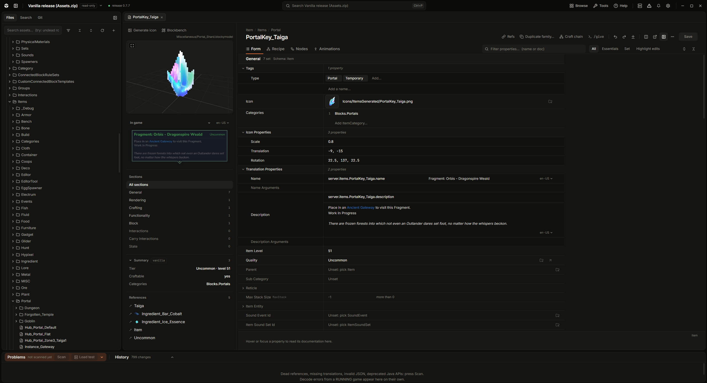
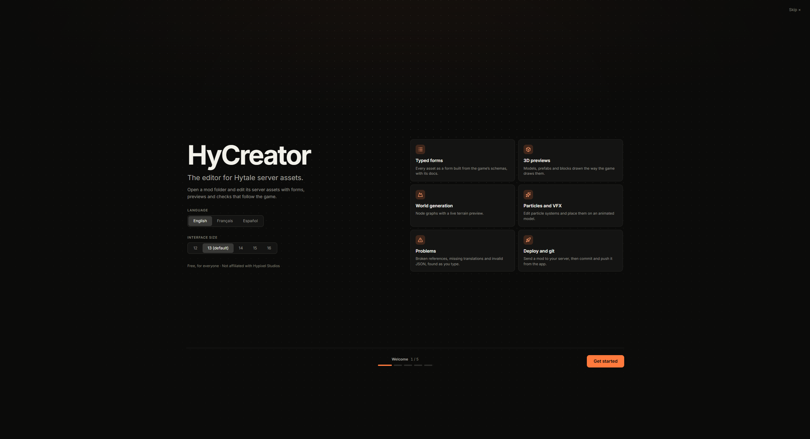

# HyCreator

**A free desktop editor for Hytale mod assets, for Windows and Linux.**

[Download](#download) · [Getting started](#getting-started) · [Features](#features) · [Discord](https://discord.gg/7kbpXhSRrV)

HyCreator edits the content of a Hytale mod: items, blocks, NPCs, recipes, drop lists, particles, prefabs, world generation, translations and custom UI. Every file opens as a form with a preview of the result next to it, so you can build and check a mod without launching the game.

It is an alternative to the game's built-in Asset Editor that goes further: more kinds of content, live previews, dedicated tools, and checks that point at the exact field the game would refuse.

## Download

Get the latest build from the [Releases page](https://github.com/lewai1/HyCreator-releases/releases/latest).

| System | File | How to run |
| --- | --- | --- |
| Windows 10 / 11 | `HyCreator.exe` | No installer. Put it anywhere and run it. |
| Any Linux | `HyCreator.AppImage` | `chmod +x HyCreator.AppImage`, then run it. |
| Debian / Ubuntu | `HyCreator_x.y.z_amd64.deb` | `sudo apt install ./HyCreator_x.y.z_amd64.deb` |
| Fedora / RHEL / openSUSE | `HyCreator-x.y.z-1.x86_64.rpm` | `sudo dnf install ./HyCreator-x.y.z-1.x86_64.rpm` |

- **Portable.** The Windows exe is a single file of about 40 MB. Installing is optional: one button in Settings copies it to a per-user folder and adds a Start menu shortcut, with no setup wizard and no admin rights.
- **Self-updating.** The exe and the AppImage check for a new release when they start and can install it themselves. The `.deb` and `.rpm` packages are updated by installing the new package.
- **Windows needs the WebView2 runtime.** It comes with Windows 11 and recent Windows 10, otherwise [download it here](https://developer.microsoft.com/en-us/microsoft-edge/webview2/).
- **SmartScreen may warn on the first launch**, because the exe is not code-signed yet. Click **More info**, then **Run anyway**. You can check any release file on [VirusTotal](https://www.virustotal.com/gui/home/upload).

## Getting started

1. **Start HyCreator.** It finds your game install and reads the vanilla assets from its `Assets.zip`. With [Shared Source](https://accounts.hytale.com/shared-source) access you can point it at the `HytaleAssets` folder of your clone instead.
2. **Open a workspace:** a mod folder, a whole mods folder, a `.zip` or `.jar` pack, or the vanilla assets in read-only mode.
3. **Open a file, edit it, save with Ctrl+S.** Vanilla assets your mod references are found automatically, and a save rewrites only the values you changed, so a git diff shows your edit and nothing else.
4. **Press F1** for the built-in help. It covers every editor and shortcut.

## Features

### Editing

- Forms built from the game's own schemas: documentation on hover, completion wherever an id is expected, lists for enums.
- A Problems panel for broken references, wrong values, deprecated fields and unused assets, each one leading to its field.
- Renaming an asset updates every reference to it. A vanilla asset can be copied into your mod with everything it depends on, and compared with the file it overrides.
- Quick open (Ctrl+P), search in files, a command palette, split view, detachable windows, themes, local history and automatic backups.

### Previews

- Models and NPCs in 3D with their gear and animations.
- Item icons and tooltips as the game shows them.
- Particles, prefabs, weather, status effects and custom UI files.

### Dedicated editors

- **Particles:** a timeline, a gallery of every system, variations side by side, and an effect played in the attack that spawns it.
- **MobStudio:** an NPC's attacks on a timeline, with hit volumes, projectiles, sounds and effects on the animated mob.
- **Hitboxes:** drawn on the model, fitted to it or generated for a model that has none.
- **Prefabs:** the game's building tools (brushes, fill, replace, fluids, transforms) with undo.
- **World generation:** a node editor with a terrain preview for worldgen V2; forms, a map, a vertical cut and a 3D view for worldgen V1 (pre-release).
- **NPC roles** as behaviour graphs, with combat action curves and scoring.
- **Drop lists** with drop chances and a roll simulation, **recipes** in their crafting layout, **ability runes** and **translations**.
- **Animation Studio:** any player animation with any item in hand.

### Working on a mod

- A whole mods folder opens in the game's load order and shows which copy of an asset wins.
- [Patchly](https://www.curseforge.com/hytale/mods/patchly) and [Patchwork](https://www.curseforge.com/hytale/mods/patchwork) patch files, with a preview of the merged result.
- Git: review changes, commit the files you pick, pull, push, branches and tags, through your own git install.
- Java plugins: Gradle build from the app (Ctrl+B), completion against the server jar and a server API browser.
- Server Link: edit a server's files over SFTP or a Pterodactyl panel, saves upload on their own.
- Release and pre-release are both followed: a mod is read with the rules of the game version it targets.

## Good to know

- **HyCreator ships none of the game's assets.** Models, textures, sounds and game files are read from your own installed copy of Hytale.
- **Open source is planned.** This repository only hosts the release builds for now.
- **It is an unofficial community tool**, not affiliated with or endorsed by Hypixel Studios.

## Field descriptions

Many asset fields have no description in the game's schemas. The [hytale-field-descriptions](https://github.com/lewai1/hytale-field-descriptions) repository collects descriptions written by modders, and HyCreator shows them as tooltips, marked as community text. Official documentation always takes priority.

To suggest one, right-click a field without a description and choose **Suggest a description**. It opens a pre-filled GitHub issue.

## Feedback

Questions, bugs and ideas are welcome on the [Discord server](https://discord.gg/7kbpXhSRrV). Issues on this repository are read too.

## Credits

Thanks to [DemoHytale](https://x.com/DemoHytale) for the name, [Starky_TV](https://x.com/Starky_TV) for the icon, and everyone who tests the builds and reports bugs.

---

*Hytale and its assets belong to their respective owners.*
